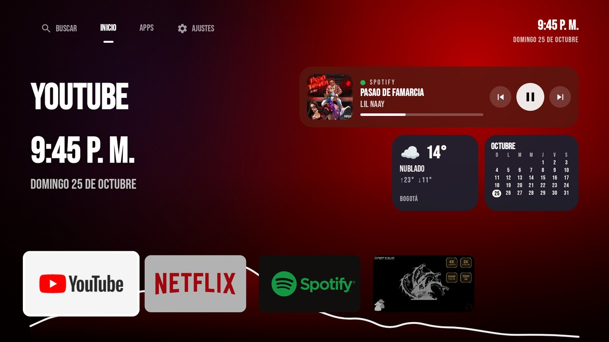
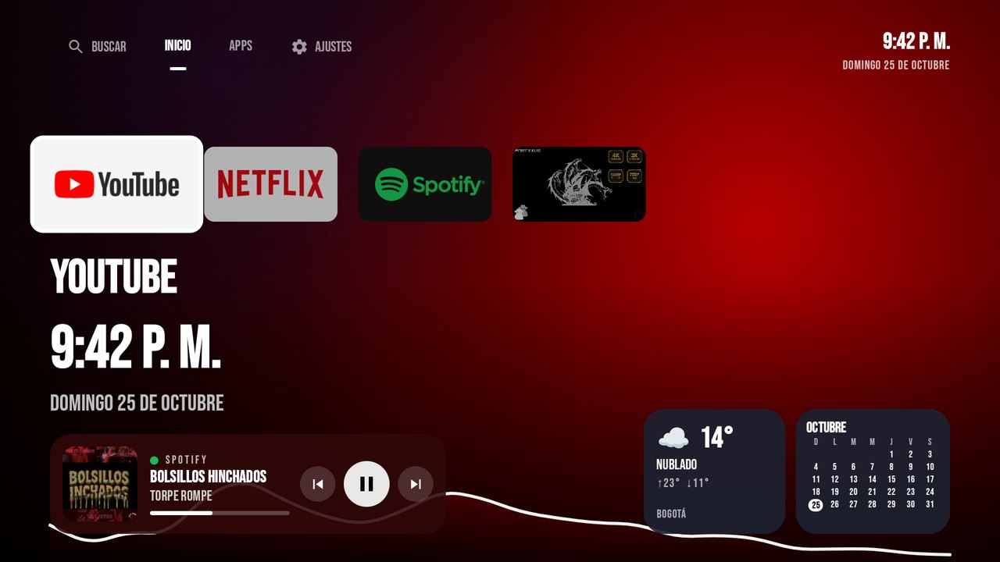
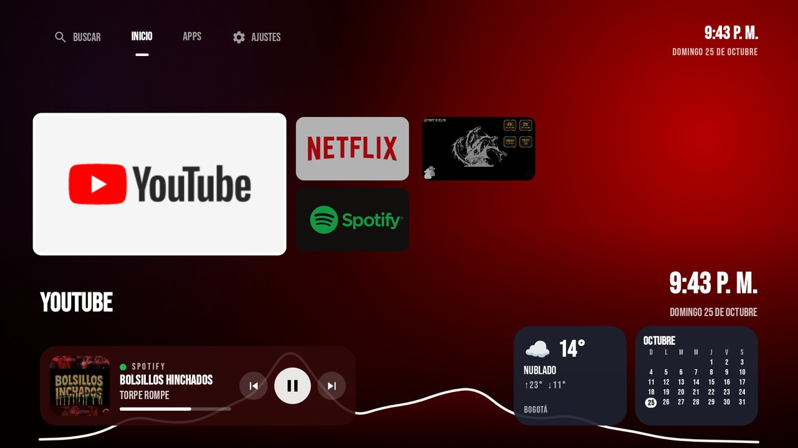
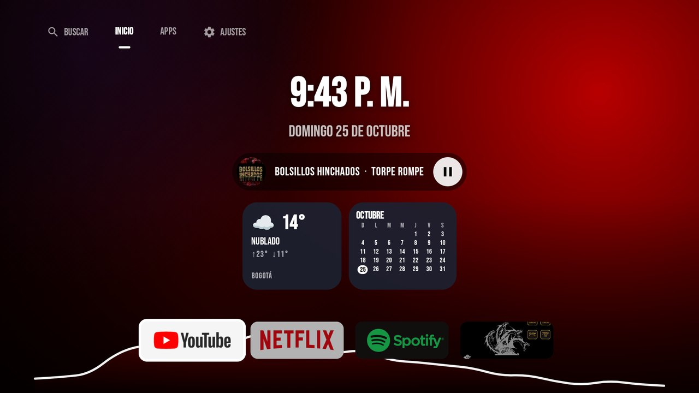
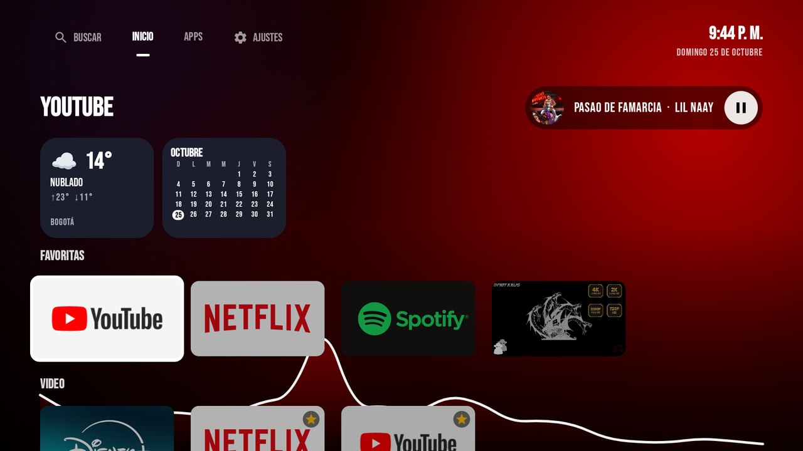
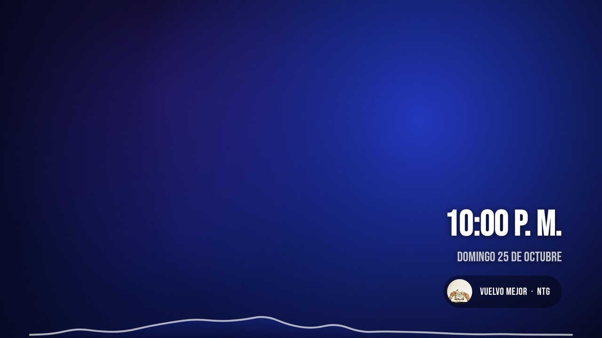
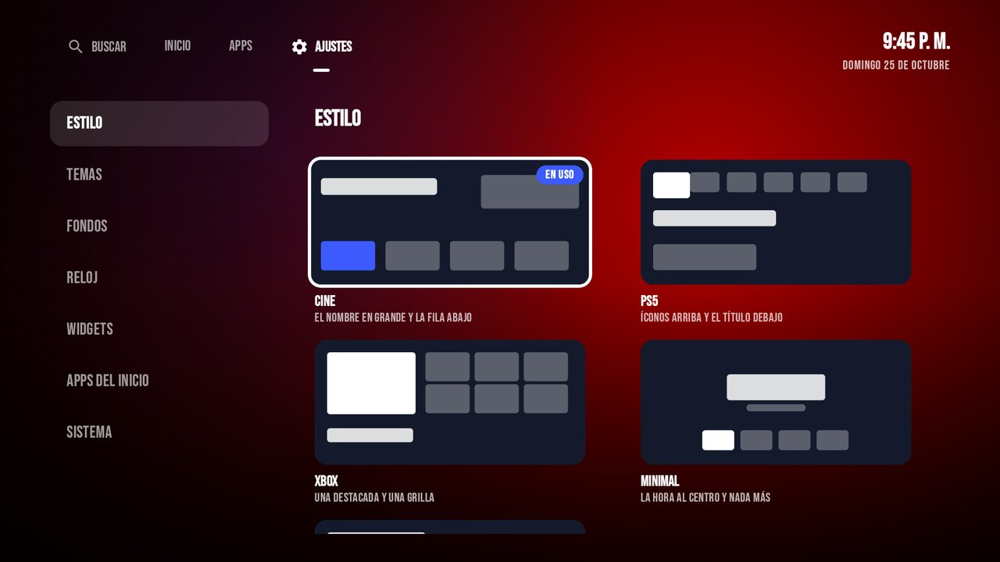
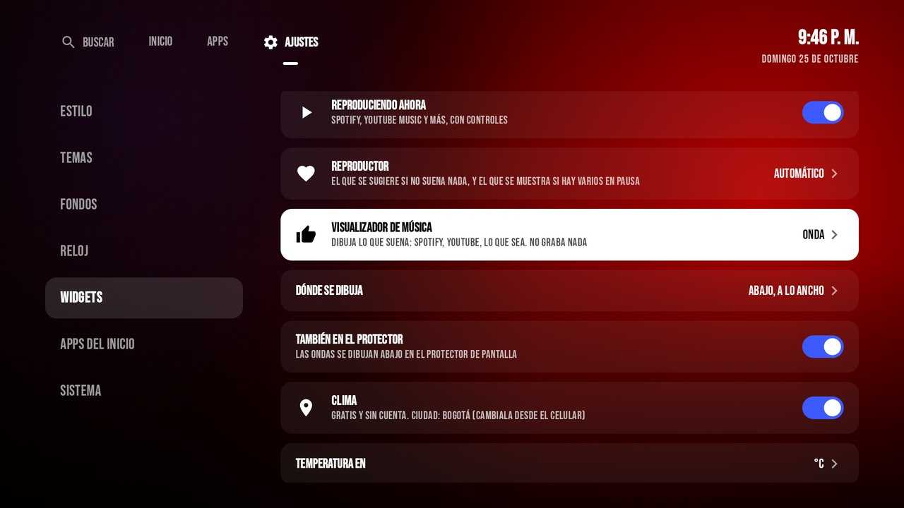
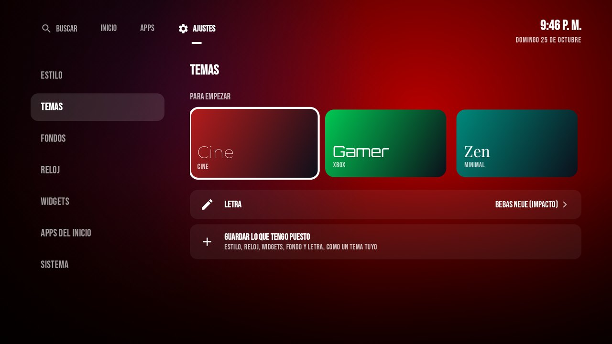
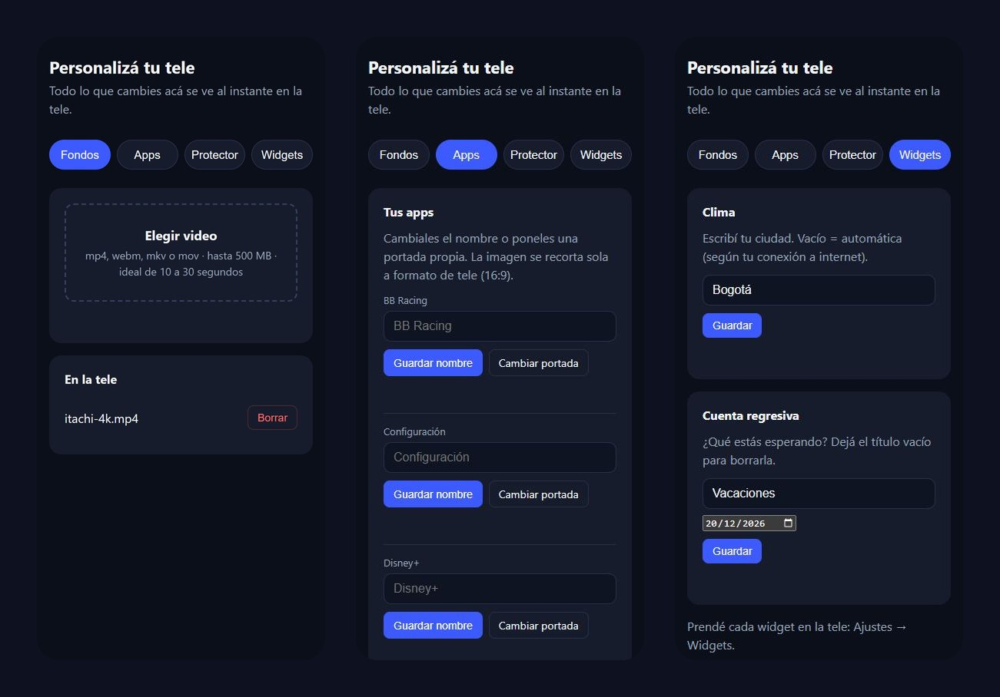

<div align="center">

# Consola Launcher

**Un inicio para Google TV sin anuncios, con estilo de consola, fondos animados y todo personalizable.**

*A clean, ad-free, console-style home screen for Google TV with live wallpapers, widgets and a music visualizer.*

[](https://github.com/Gabriel39807/consola-launcher/actions/workflows/ci.yml)
[](https://github.com/Gabriel39807/consola-launcher/releases/latest)
[](LICENSE)




</div>

---

## ¿Qué es?

Google TV llena el inicio de recomendaciones y publicidad. **Consola** lo reemplaza por uno limpio que armás a tu gusto: cinco estilos inspirados en consolas, fondos de video que subís desde el celular, widgets, un visualizador que dibuja la música y un panel de ajustes rápidos propio. Corre en teles económicas (probado en una KTC/Challenger 4K con Android TV 14, 1,8 GB de RAM y GPU Mali-G52) y cada animación está medida en la tele.

## Lo que tiene

| | |
|---|---|
| 🎮 **5 estilos de Inicio** | Cine, PS5, Xbox, Minimal y Filas (tus apps agrupadas por tipo). Se cambian en un clic. |
| 🎞️ **Fondos vivos** | Videos en loop que subís desde el celular con un QR (se convierten solos a 1080p), o una aurora que toma el color de la app enfocada. Rotación, uno de día y otro de noche, y oscurecido. |
| 🎵 **Música** | Widget "Reproduciendo ahora" para Spotify, YouTube Music y cualquier reproductor, con el color del disco y controles. |
| 📊 **Visualizador** | Barras, Onda, Espejo o un fondo que late con los graves. Abajo a lo ancho, dentro de la tarjeta de la música, y en el protector. |
| ⛅ **Widgets** | Clima (sin cuenta), cuenta regresiva, calendario del mes y reloj grande. |
| ⚙️ **Ajustes rápidos** | El botón Ajustes del control abre un panel lateral al instante: lo que suena, volumen, **entradas HDMI directas** y atajos. Mantenerlo 3 s abre los ajustes de la tele. |
| 🎨 **Temas y letras** | Temas listos (Cine, Gamer, Zen, Arcade) o los tuyos, cuatro letras, reloj a medida. |
| 📱 **Desde el celular** | Subí fondos, cambiá el nombre y la portada de cada app, el mensaje del protector, la ciudad del clima y la cuenta regresiva. |
| 🌙 **Protector de pantalla** | Tu fondo con la hora y la canción, moviéndose para no marcar la pantalla. |
| 🚫 **Sin publicidad** | Reemplaza el inicio de Google de forma reversible, y atiende los botones del control que dependían de él. |

## Capturas

| Cine | PS5 | Xbox |
|:---:|:---:|:---:|
|  |  |  |
| **Minimal** | **Filas** | **Protector de pantalla** |
|  |  |  |
| **Ajustes → Estilo** | **Ajustes → Widgets** | **Ajustes → Temas** |
|  |  |  |

**La página del celular** (se abre con el QR de Ajustes, en la misma WiFi):



## Instalación rápida

> Necesitás una tele con Google TV / Android TV y una PC con [ADB](https://developer.android.com/tools/releases/platform-tools). La guía completa, paso a paso, está más abajo.

1. Bajá el APK de la [última versión](https://github.com/Gabriel39807/consola-launcher/releases/latest).
2. Activá la depuración en la tele y conectate (ver [Paso 1](#paso-1-preparar-la-tele)).
3. Instalalo y probalo como una app más, **sin tocar nada del sistema**:
   ```bash
   adb install consola-launcher.apk
   ```
4. Si te gusta, hacelo tu inicio (todo reversible con [`restore.ps1`](scripts/restore.ps1)):
   ```bash
   powershell -ExecutionPolicy Bypass -File .\scripts\debloat.ps1 -Device 192.168.1.50:5555
   ```

¿Preferís compilarlo? `./gradlew assembleRelease` (o abrí la carpeta en Android Studio).

## Privacidad

- **Sin cuentas, sin anuncios, sin analíticas.** Consola no manda nada tuyo a ningún lado.
- **Red:** el clima usa [Open-Meteo](https://open-meteo.com); si no elegís ciudad, la deduce de tu conexión con ipapi.co (o ipwho.is). Eso es todo lo que sale de la tele, y solo con el widget de clima prendido.
- **Página del celular:** vive en tu red local, solo mientras estás en Ajustes, y cada vez con un código distinto en la dirección.
- **Micrófono:** Android lo exige para *analizar* el audio que suena (el visualizador). No se graba ni se guarda nada.

## Hecho con

Kotlin · Jetpack Compose for TV · Media3 (ExoPlayer y Transformer) · DataStore · NanoHTTPD · ZXing. Arquitectura por funcionalidad, inyección de dependencias a mano y la lógica pura testeada sin emulador (`./gradlew testDebugUnitTest`).

**Contribuir:** leé [CONTRIBUTING.md](CONTRIBUTING.md). **Cambios por versión:** [CHANGELOG.md](CHANGELOG.md). **Licencia:** [MIT](LICENSE) (las letras, OFL).

---

# Guía completa

## Antes de tocar código: 3 conceptos

### 1. ¿Qué ES un launcher?
Es una app normal y corriente. No hay ninguna magia. Lo único que la hace especial es este `intent-filter` del [AndroidManifest.xml](app/src/main/AndroidManifest.xml):

```xml
<category android:name="android.intent.category.HOME" />
```

Cuando apretás Home, Android busca qué Activity declara `HOME` y la abre. Google TV es UNA de esas apps (`com.google.android.apps.tv.launcherx`). Si la desactivás, la nuestra pasa a ser la única candidata. Así de simple.

### 2. En la tele, el FOCO es todo
En el celular tocás la pantalla. En la tele no hay dedos: tenés un D-pad (las flechas del control). Siempre hay **un** elemento enfocado, y las flechas mueven el foco. Si nadie tiene el foco, el control no hace NADA. Por eso:
- [AppTile.kt](app/src/main/java/com/consola/launcher/home/AppTile.kt) dibuja el foco (escala + borde).
- [HomeScreen.kt](app/src/main/java/com/consola/launcher/home/HomeScreen.kt) le da el foco al primer tile al arrancar.
- [VideoBackground.kt](app/src/main/java/com/consola/launcher/background/VideoBackground.kt) marca el reproductor como NO enfocable, porque si no, el reproductor se queda con las flechas.

### 3. Los decodificadores de video son un recurso escaso
Una tele económica tiene muy pocos decodificadores de video por hardware. Si tu fondo se queda con uno mientras mirás Netflix, Netflix puede quedarse sin él. Por eso el reproductor se **crea** cuando el inicio aparece y se **libera** cuando se oculta (`LifecycleStartEffect`). No es un detalle: es lo que separa un launcher usable de uno que te rompe las otras apps.

---

## Estructura (Screaming Architecture: las carpetas dicen QUÉ hace la app)

```
app/src/main/java/com/consola/launcher/
├── apps/          → qué apps hay, en qué orden, de qué tipo, y sus portadas propias
├── audio/         → escuchar lo que suena: graves/medios/agudos y el espectro del visualizador
├── background/    → fondos animados (video + aurora) y la biblioteca de videos
├── dream/         → el protector de pantalla
├── home/          → el armazón: pestañas, los 5 estilos de Inicio y Apps
├── keys/          → el botón Ajustes y los botones del control que atendía Google
├── quickpanel/    → el panel de ajustes rápidos (una capa sobre todo)
├── search/        → la pestaña Buscar (abre el Asistente de Google)
├── settings/      → Ajustes y todo lo que se guarda (DataStore), temas incluidos
├── upload/        → la página del celular: servidor HTTP, QR y conversión a 1080p
├── weather/       → el clima (Open-Meteo)
├── widgets/       → música, visualizador, clima, cuenta regresiva y calendario
├── ui/            → tema, letras, reloj y márgenes seguros
├── LauncherGraph.kt  ← una instancia de cada cosa para toda la app (DI a mano)
└── LauncherConfig.kt ← favoritas y ocultas POR DEFECTO (después se cambian desde Ajustes)
```

`AppCatalog` no sabe nada de Android. ¿Y sabés por qué? Porque así lo testeás en milisegundos, sin emulador: [AppCatalogTest.kt](app/src/test/java/com/consola/launcher/apps/AppCatalogTest.kt).

---

## Paso 1: Preparar la tele

1. **Ajustes → Sistema → Acerca de** → apretá **7 veces** sobre *Compilación del SO de Android TV* hasta que diga que sos desarrollador.
2. **Ajustes → Sistema → Opciones para desarrolladores** → activá **Depuración USB** y, si aparece, **Depuración inalámbrica**.
3. Anotá la IP de la tele (**Ajustes → Red e Internet** → tu red).

En la PC instalá las herramientas de ADB:

```bash
winget install Google.PlatformTools
```

Conectate. En Android TV 14 normalmente hay que **emparejar** primero: la tele te muestra IP, puerto y un código en *Depuración inalámbrica → Vincular dispositivo*.

```bash
adb pair 192.168.1.50:37123
```

```bash
adb connect 192.168.1.50:5555
```

> El puerto de `pair` y el de `connect` suelen ser DISTINTOS: los dos te los muestra la tele. Aceptá el diálogo "¿Permitir depuración?" en la pantalla.

## Paso 2: Compilar e instalar

1. Instalá [Android Studio](https://developer.android.com/studio).
2. **File → Open** → elegí la carpeta `consola-launcher`. Esperá a que termine el *Gradle Sync*.
3. Arriba, en el selector de dispositivos, debería aparecer tu tele (por estar conectada por ADB). Dale **Run ▶**.

Para correr los tests: clic derecho en `AppCatalogTest` → **Run**.

## Paso 3: Probalo SIN tocar nada del sistema

Consola aparece como una app más en la tele. Abrila desde ahí y movete con el control. Si algo no te gusta, ajustalo ACÁ, cuando todavía no reemplazaste nada. Primero se prueban las paredes, después te mudás.

## Paso 4: Tu fondo animado

### Desde el celular (lo normal)

En la tele: **Ajustes → Fondos**. Aparece un QR. Escanealo con el celular (tiene que estar en la misma WiFi), elegí un video y listo. La tele lo **adapta sola** a 1080p H.264 con su codificador por hardware (Media3 Transformer) y lo deja como fondo. Desde esa misma página del celular también podés borrar fondos.

Detalles de seguridad:
- El servidor existe **solo mientras Ajustes → Fondos está en pantalla**. Salís, y se cierra.
- La dirección lleva un **código aleatorio** que cambia cada vez. Sin él, el servidor responde 404 a todo.
- Solo acepta videos (mp4, webm, mkv, mov) de hasta 500 MB. El nombre del archivo se limpia, porque lo manda otro dispositivo.

### Desde la PC (por ADB)

Desde PowerShell, en la carpeta `scripts`:

```bash
powershell -ExecutionPolicy Bypass -File .\push-background.ps1 -Device 192.168.1.50:5555 -Video C:\Videos\fondo.mp4
```

El script **convierte el video solo** a 1080p H.264 sin audio, si tenés ffmpeg (`winget install Gyan.FFmpeg.Essentials`). Ojo: los videos que bajás de YouTube suelen ser **WebM/VP9 en 4K aunque se llamen `.mp4`**. La interfaz se dibuja a 1080p, así que el 4K es trabajo que no se ve.

**Recomendaciones para el video:**
- Entre 10 y 30 segundos, pensado para hacer un loop sin corte visible.
- Oscuro o de colores apagados: el texto blanco tiene que leerse encima.

> **Por qué el video usa TextureView y no SurfaceView** (medido en una Challenger con Mali-G52): con SurfaceView, el video queda en una capa aparte que el hardware de la tele no puede mostrar debajo de la interfaz. El sistema la compone con la GPU, escalada a la salida 4K en cada frame (`Comp Type: CLIENT` en `dumpsys SurfaceFlinger`), y navegando el 100 % de los frames salía trabado. Con TextureView, el video es una textura más dentro de la app: queda una sola capa por hardware y solo el **0,75 %** de los frames sale trabado. Ver [background_player.xml](app/src/main/res/layout/background_player.xml).

Si no subís ningún video, o si el video no se puede reproducir, se usa la aurora animada. Nunca te queda una pantalla negra.

> **Por qué la tele convierte los videos** (medido): un 4K VP9 como fondo deja la GPU en ~32 ms por frame y **65 %** de frames trabados con el inicio quieto. El mismo video en 1080p H.264: ~10 ms y **0 %**.

## Paso 5: Sacar el inicio de Google

Primero mirá lo que haría, sin tocar nada:

```bash
powershell -ExecutionPolicy Bypass -File .\debloat.ps1 -Device 192.168.1.50:5555 -WhatIf
```

Y ahora sí:

```bash
powershell -ExecutionPolicy Bypass -File .\debloat.ps1 -Device 192.168.1.50:5555
```

Apretá Home: abre Consola. Y al prender la tele también arranca Consola, porque es el único inicio que queda.

> **Por qué a veces hay que sacar dos cosas de Google:** Android elige el Home por *prioridad* antes que por preferencia. En muchas teles el asistente de configuración de Google (`setupwraith`, prioridad 1) le gana a cualquier launcher instalado (prioridad 0). El script lo detecta: si después de sacar el inicio de Google el Home cae en el asistente, lo desactiva también. Con `-IncludeSetupWraith` lo forzás.

> **El botón Ajustes del control** abría un panel que vive *dentro* del inicio de Google, y Android solo deja reemplazarlo a una app de sistema. Por eso el script activa **Consola · Botón Ajustes**, un servicio de accesibilidad que atrapa SOLO esa tecla (no lee la pantalla ni ninguna otra):
>
> - **Un toque:** abre los **ajustes rápidos de Consola**, un panel lateral encima de lo que estés viendo, sin pausarlo. Es una capa que queda armada y escondida desde que arranca el servicio: abrirla es solo deslizarla, por eso aparece al instante (escondida no se dibuja ni escucha nada). Tiene:
>   - **Lo que está sonando:** OK pausa, IZQUIERDA/DERECHA cambian de canción.
>   - **Volumen:** IZQUIERDA/DERECHA lo cambian y OK silencia.
>   - **Entradas:** HDMI 1, 2, 3, AV y antena, con el nombre que les pusiste en la tele. Un clic y estás ahí; el punto verde indica que hay algo prendido.
>   - **Atajos:** Imagen, Sonido, Red, Apagado, Protector, Controles, Accesibilidad, Personalizar y Más ajustes. Los que no existen en tu tele no aparecen.
>
>   Back, Home u otro toque lo cierran.
> - **Mantenerlo 3 segundos:** abre los ajustes completos de la tele.
>
> **Otros botones que solo atendía el inicio de Google** (salen en `dumpsys window policy`) ahora los atiende Consola:
>
> | Botón | Qué hace ahora |
> |---|---|
> | Todas las apps | Abre la pestaña Apps de Consola |
> | Guía | Abre la TV en vivo |
> | Notificaciones | Abre los ajustes rápidos |
>
> El botón de Prime Video lo maneja la tele: si la app no está instalada, no hace nada (instalala desde la Play Store).
>
> En las teles KTC el botón llega como `KEYCODE_FOCUS`, no como `KEYCODE_SETTINGS`, y el servicio entiende los dos. Ojo: las teclas que se mandan con `adb shell input keyevent` no pasan por estos servicios. Para probarlo, usá el control de verdad.

> ⚠️ Después de hacer esto, probá que el botón de **entradas/HDMI** del control siga funcionando. En algunas teles con Google TV, el selector de entradas vive dentro del inicio de Google.

## Si algo sale mal

Todo es reversible:

```bash
powershell -ExecutionPolicy Bypass -File .\restore.ps1 -Device 192.168.1.50:5555
```

Con `-UninstallLauncher` además desinstala Consola. Y en el peor de los casos, un reset de fábrica vuelve a activar todo.

---

## Personalizar

- **Favoritas y apps ocultas:** desde la tele, en **Ajustes → Apps del inicio**. Los valores de fábrica están en [LauncherConfig.kt](app/src/main/java/com/consola/launcher/LauncherConfig.kt).
- **Fondo:** en **Ajustes → Fondos** elegís entre la aurora y tus videos.
- **Ordenar el Inicio:** en Inicio, **mantené OK** sobre una app. Se agranda con flechas: movela con ◀ ▶ y soltala con OK (o Atrás).
- **Agregar o sacar del Inicio:** en Apps, **mantené OK** sobre cualquier app. Las que están en Inicio llevan una estrellita.
- **Estilo del Inicio:** en **Ajustes → Estilo** elegís entre **Cine**, **PS5**, **Xbox**, **Minimal** y **Filas** (tus apps agrupadas solas por tipo: Video, Música, Juegos). Todos comparten tus favoritas, el "mantener OK para mover" y los widgets.
- **Reloj:** en **Ajustes → Reloj** cambiás formato (24 h / 12 h), segundos, fecha (completa, corta, solo el día u oculta), grosor y tamaño. Se aplica a la barra, al Inicio Minimal, al widget y al protector de pantalla.
- **Widgets:** en **Ajustes → Widgets** activás **Reproduciendo ahora** (carátula, canción, avance y controles, con el color del disco) y **Reloj grande**. Funciona con **Spotify y YouTube Music** (y cualquier reproductor): cada uno con su color. En **Reproductor** elegís el tuyo (Automático, Spotify o YouTube Music): es el que se sugiere si no suena nada y el que se muestra si hay varios en pausa. Los temas no lo cambian. El de música necesita "acceso a notificaciones": la fila "Permitir ver qué está sonando" abre la pantalla de la tele para darlo, o lo da `debloat.ps1`.
  - **Visualizador de música:** dibuja lo que suena con 4 estilos: **Barras**, **Onda**, **Espejo** (barras desde el centro, con los graves en el medio) y **Fondo que late** (el fondo que baila de antes). Elegís **dónde**: **abajo, a lo ancho** (las barras suben por DETRÁS de las apps, como el escenario de un ecualizador: no ocupa lugar y no se pisa con nada) o **dentro de la música** (de fondo en la tarjeta o la cápsula de la canción, más tenue: no suma alto ni empuja a los otros widgets). Con **También en el protector** las ondas se ven abajo en el protector de pantalla. Toma el color de la app enfocada y en silencio se apaga. Pide permiso de micrófono porque Android lo exige para analizar el audio; no graba nada.
  - **Clima:** temperatura, estado y máxima/mínima del día. Gratis y sin cuenta ([Open-Meteo](https://open-meteo.com)). La ciudad se detecta sola por tu conexión (ipapi.co, o ipwho.is si no responde) o la escribís desde el celular. °C o °F.
  - **Cuenta regresiva:** "Faltan 61 días para Vacaciones". Título y fecha desde el celular.
  - **Calendario del mes:** con el día de hoy marcado; arranca el lunes o el domingo según tu país.
  - Cada estilo de Inicio los ubica donde le quedan bien, medidos para que nada se pise (la tele tiene 960 × 540 dp útiles): en **Cine**, arriba a la derecha bajo la música, con el mismo ancho que la tarjeta (440 dp); en **PS5**, abajo a la derecha (reloj y música a la izquierda); en **Xbox**, el nombre arriba y abajo música e info lado a lado; en **Minimal**, en una columna con espacios flexibles bajo la hora; en **Filas**, como primera fila.
- **Temas:** en **Ajustes → Temas** aplicás un look completo con un clic (Cine, Gamer, Zen, Arcade) o guardás el tuyo. Un tema cambia estilo, reloj, música, reloj grande, estilo del visualizador, oscurecido y letra, pero NUNCA tus apps, tus fondos, tu reproductor, dónde va el visualizador ni tus widgets de información.
- **Letras:** Montserrat, Orbitron, Playfair y Bebas Neue (licencia OFL, en `assets/licenses`), o la de la tele.
- **Fondos vivos:** en **Ajustes → Fondos → Cómo se ve**: cambiar de fondo solo (cada 15, 30 o 60 minutos, o uno de día y otro de noche: mantené OK sobre un fondo para marcarlo), y oscurecer el fondo. (Que el fondo lata con la música ahora es un estilo del visualizador, en Widgets).
- **Desde el celular:** el QR de Ajustes abre una página con cuatro pestañas: **Fondos** (subir y borrar videos), **Apps** (cambiar el nombre y subir una portada propia a cada app; se recorta sola a 16:9), **Protector** (un mensaje debajo de la hora) y **Widgets** (la ciudad del clima y la cuenta regresiva). El servidor vive solo mientras estás en Ajustes.
- **Protector de pantalla:** **Ajustes → Sistema → Protector de pantalla** usa tu mismo fondo con la hora, que cambia de esquina cada minuto para no marcar la pantalla. Google TV no tiene una pantalla para elegir protectores, así que el permiso para cambiarlo se da una sola vez con `debloat.ps1` (si no lo querés, pasale `-KeepGoogleScreensaver`).

- **Tamaño de los tiles, escala del foco:** las constantes al principio de [AppTile.kt](app/src/main/java/com/consola/launcher/home/AppTile.kt).
- **Colores de la aurora:** las constantes al principio de [AuroraBackground.kt](app/src/main/java/com/consola/launcher/background/AuroraBackground.kt).

## Ideas para seguir (en orden de dificultad)

1. Un fondo distinto para cada app enfocada (como en la PS5 con cada juego).
2. Varias filas en Inicio (Favoritas / Recientes / Juegos).
3. Un plan B para el botón Home, por si un update de Google lo rompe: un servicio de accesibilidad que detecte cuando aparece el inicio de Google y abra Consola.

## Cómo se dibuja la música

[AudioPulse.kt](app/src/main/java/com/consola/launcher/audio/AudioPulse.kt) usa el `Visualizer` de Android sobre la sesión 0 (la mezcla de todo lo que suena) y [AudioLevels.kt](app/src/main/java/com/consola/launcher/audio/AudioLevels.kt) convierte la FFT en graves, medios y agudos, suavizados para que "suba rápido y baje lento".

Para el visualizador, [Spectrum.kt](app/src/main/java/com/consola/launcher/audio/Spectrum.kt) reparte la FFT en 24 barras en escala **logarítmica** (como el oído: de 50 a 100 Hz hay tanta música como de 5 a 10 kHz) y las normaliza contra el pico reciente, así se ve igual con la tele fuerte o baja. La captura es de 1024 muestras (casilleros de ~47 Hz): con 256 eran de 187 Hz y todo el bajo caía en una o dos barras. El audio llega ~20 veces por segundo y [MusicVisualizer.kt](app/src/main/java/com/consola/launcher/widgets/MusicVisualizer.kt) lo interpola a cada cuadro, leyéndolo en la fase de dibujo: solo se redibuja el lienzo.

**Rendimiento (medido en la tele):** el visualizador se dibuja en su propia capa (sin eso, cada cuadro volvía a grabar todo el Inicio: 86 % de CPU), a 30 cuadros por segundo (el audio llega a 20) y con una compuerta de ruido: con la música en pausa la mezcla de la tele trae un soplido que, normalizado, movía las barras solas. En silencio no se pide ni un cuadro. El audio se analiza solo en la pestaña Inicio: en Apps, Ajustes u otra app, Consola usa ~0,5 % de CPU.

En el fondo que late: En la aurora, la luz principal crece con los graves; sobre un video, el degradé se aclara en cada golpe. El pulso se lee en la fase de **dibujo**, no de composición: 20 veces por segundo se redibuja el fondo, no toda la pantalla. Ojo: algunas teles mandan el audio por un camino de hardware que no se puede analizar; en ese caso la opción avisa "Esta tele no deja analizar el audio".

## Cómo sabe el widget qué está sonando

Spotify no le da esa información a otras apps directamente. Pero toda app de música publica una **sesión de medios** para que el control remoto y el sistema la puedan manejar: [NowPlayingSource.kt](app/src/main/java/com/consola/launcher/widgets/NowPlayingSource.kt) lee esa sesión con `MediaSessionManager`. Android solo se la muestra a las apps con acceso a notificaciones, y por eso existe [MediaListener.kt](app/src/main/java/com/consola/launcher/widgets/MediaListener.kt), que no lee ninguna notificación. Android lista solo las sesiones **activas**: si la tele se duerme y la música se corta, el widget muestra "Nada sonando" y un botón para abrir Spotify.

## Mantener OK: por qué no alcanza con `clickable()`

`clickable()` de Compose no distingue "apretar" de "mantener" OK en un control remoto. [TvClickable.kt](app/src/main/java/com/consola/launcher/ui/TvClickable.kt) lo resuelve con la misma regla que usa Android: mientras mantenés la tecla, el sistema la repite, y al cumplirse su tiempo de "mantener" marca la repetición con `FLAG_LONG_PRESS`. Al principio usé un umbral propio más largo (600 ms) y con un control que repite una sola vez quedaba como "toque" y abría la app. Usar la marca del sistema lo hace coincidir con el resto de la tele.

## Un detalle de foco que vale la pena entender

Al subir desde una app hacia las pestañas, la búsqueda de foco 2D de Compose elige la pestaña **más cercana en línea recta**: desde Spotify caía en Ajustes y te cambiaba de pestaña sin querer. `focusRestorer()` no lo evitó (medido en la tele). La solución en [HomeScreen.kt](app/src/main/java/com/consola/launcher/home/HomeScreen.kt) es determinística: mientras el foco está en el contenido, las pestañas no son enfocables. ARRIBA primero intenta moverse dentro del contenido, y si ya no hay nada más arriba, va a la pestaña donde estabas.

Mismo criterio en otros lugares:
- **Ajustes:** ABAJO desde las pestañas entra al menú de secciones (en la sección donde estás), e IZQUIERDA desde cualquier panel vuelve a esa sección, no a la que quede a la misma altura. Usa `focusProperties { enter / exit }` en [SettingsScreen.kt](app/src/main/java/com/consola/launcher/settings/SettingsScreen.kt).
- **Home con Consola abierta:** desde cualquier pestaña te lleva al Inicio, con el foco en tu primera app ([MainActivity.kt](app/src/main/java/com/consola/launcher/MainActivity.kt) mira la categoría HOME en `onNewIntent`).
